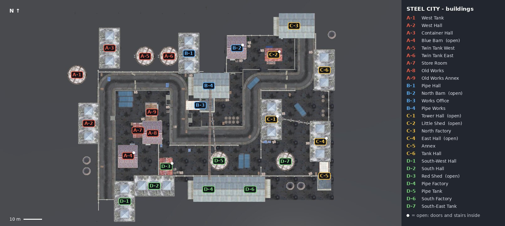

# Steel City (CityLord) — buildings and places

Every building on the map has a code (district letter and number) and a short name. The code and the
Pashto name are written on its plate in the game; the board of each district gives its letter.

North is up (+Z), east is right (+X). Positions are the building's centre on the ground in metres, in
the map's own coordinates (X, Z; the map's ground is lifted 12.92 m in the world, which changes Y only).
Size is the footprint (east-west × north-south) and the height. "Open" buildings have doors and stairs inside.

| Code | پښتو نوم | Name | Kind | Centre X | Centre Z | Size (m) | Height (m) | Open |
|---|---|---|---|---:|---:|---|---:|:---:|
| A-1 | لوېدیځ ټانک | West Tank | oil tank | -39.0 | 14.9 | 10.7 × 10.7 | 6.4 |  |
| A-2 | لوېدیځ تالار | West Hall | big hall | -32.6 | -11.7 | 10.7 × 21.2 | 10.0 |  |
| A-3 | د کانټینرو تالار | Container Hall | big hall | -21.1 | 29.6 | 11.7 × 22.6 | 12.9 |  |
| A-4 | شین ګودام | Blue Barn | barn | -11.0 | -29.4 | 10.9 × 13.5 | 9.4 | yes |
| A-5 | لوېدیځ جوړه ټانک | Twin Tank West | oil tank | -1.6 | 25.2 | 10.7 × 10.7 | 6.4 |  |
| A-6 | ختیځ جوړه ټانک | Twin Tank East | oil tank | 11.5 | 25.2 | 10.7 × 10.7 | 6.4 |  |
| A-7 | ګدام خونه | Store Room | works building | -5.5 | -15.4 | 5.5 × 8.2 | 4.4 |  |
| A-8 | زړه کارخانه | Old Works | works hall | 2.5 | -17.0 | 10.9 × 13.5 | 9.4 |  |
| A-9 | د زړې کارخانې ضمیمه | Old Works Annex | works building | 2.1 | -5.4 | 7.3 × 10.0 | 6.7 |  |
| B-1 | د نلونو تالار | Pipe Hall | big hall | 22.4 | 26.8 | 11.7 × 22.6 | 12.9 |  |
| B-2 | شمالي ګودام | North Barn | barn | 48.8 | 29.6 | 10.9 × 13.5 | 9.4 | yes |
| B-3 | د کارخانې دفتر | Works Office | works building | 28.7 | -1.7 | 16.1 × 7.8 | 6.3 |  |
| B-4 | د نلونو کارخانه | Pipe Works | works hall | 33.4 | 9.0 | 22.9 × 13.9 | 11.5 |  |
| C-1 | د برج تالار | Tower Hall | big hall | 67.8 | -9.5 | 11.7 × 22.6 | 12.9 | yes |
| C-2 | کوچنی ګودام | Little Shed | shed | 68.9 | 26.0 | 9.7 × 7.2 | 5.0 | yes |
| C-3 | شمالي فابریکه | North Factory | factory | 80.2 | 41.8 | 22.9 × 13.9 | 11.5 |  |
| C-4 | ختیځ تالار | East Hall | big hall | 94.6 | -21.6 | 11.7 × 22.6 | 12.9 | yes |
| C-5 | ضمیمه | Annex | outbuilding | 96.8 | -40.4 | 7.8 × 16.1 | 6.3 |  |
| C-6 | د ټانکونو تالار | Tank Hall | big hall | 96.8 | 17.6 | 11.7 × 22.6 | 12.9 |  |
| D-1 | سویل لوېدیځ تالار | South-West Hall | big hall | -12.8 | -54.5 | 11.7 × 22.6 | 12.9 |  |
| D-2 | سویلي تالار | South Hall | big hall | 3.5 | -46.0 | 11.7 × 22.6 | 12.9 |  |
| D-3 | سور ګودام | Red Shed | shed | 9.9 | -35.3 | 7.2 × 9.7 | 5.0 | yes |
| D-4 | د نل فابریکه | Pipe Factory | factory | 33.2 | -47.8 | 22.9 × 13.9 | 11.5 |  |
| D-5 | د نل ټانک | Pipe Tank | oil tank | 38.9 | -32.2 | 10.7 × 10.7 | 6.4 |  |
| D-6 | سویلي فابریکه | South Factory | factory | 56.0 | -47.8 | 22.9 × 13.9 | 11.5 |  |
| D-7 | سویل ختیځ ټانک | South-East Tank | oil tank | 75.4 | -32.5 | 10.7 × 10.7 | 6.4 |  |

## Districts

- **A**: the west side — the tanks and halls on the west, the old works in the middle of the inner yard.
- **B**: the north middle — the pipe hall and the pipe works with its office, the north barn.
- **C**: the east — the tower hall, the east hall, the annex, the tank hall and the north factory.
- **D**: the south — the long factories on the south road, the south halls, the red shed and two tanks.

## Landmarks

- **The road**: one road winds through the town, from the west side round the inner yard (A-7, A-8, A-9) and up to the north-east.
- **The pipe**: runs from the roof of Pipe Works (B-4) south to the roof of Pipe Factory (D-4), over the yard
  between them.
- **Open buildings**: Blue Barn (A-4), North Barn (B-2), Tower Hall (C-1), Little Shed (C-2), East Hall (C-4)
  and Red Shed (D-3) can be entered; their plates say "خلاص" (open).
- **Oil tanks**: A-1, A-5 and A-6 along the north-west edge; D-5 and D-7 in the southern yard.

The names and positions come from the map builder (`UnityGame/Assets/Editor/CityLordTown.cs`, `BuildingNames`),
which logs every building as `[Map] CityLord <code>: <name> ... centre ... size ...` when the map is built.
